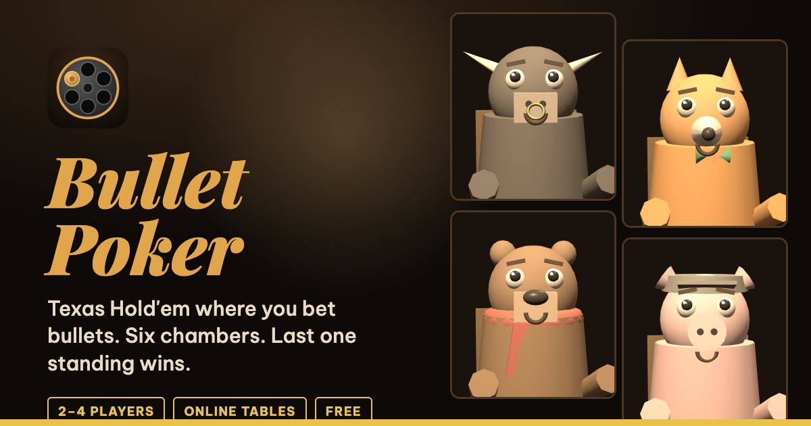

# Bullet Poker



A 3D bluffing game in the browser, inspired by *Liar's Bar*. Three games around one revolver:

- **Bullet Poker**: Texas Hold'em where you bet **bullets**, not chips
- **Liar's Deck**: play cards face down, claim they match the table card, call the liar
- **Liar's Dice**: bid on everyone's hidden dice, call the liar

**Play:** https://silky-itt.github.io/bulletpoker/

- 2–4 players online, each on their own device: host a table, share the code or link, or pick one from the open tables list. The host picks the game in the room.
- Bullet Poker: fold or lose the showdown and you pull the trigger with the bullets you loaded. Switch and Coward's Fold, once per match.
- Liar's Deck / Liar's Dice: each player has their own gun with one round; every pull makes the next one likelier (1 in 6, 1 in 5, ...)
- Low-poly animal characters with expressive faces
- Synthesized adaptive music and sound effects (Web Audio, no asset files)

## Run locally
No build step. Serve the folder with any static server:

```sh
python3 -m http.server 8000
# open http://localhost:8000
```

## Files
| File | Purpose |
|---|---|
| `index.html` | HUD, character select, input |
| `engine.js` | Cards, hand evaluator, Monte Carlo equity |
| `game.js` | Bullet Poker rules and turn flow (no DOM) |
| `liars.js` | Liar's Deck and Liar's Dice rules (no DOM) |
| `scene.js` | Three.js scene, characters, camera |
| `audio.js` | Web Audio music and SFX |
| `net.js` | Online tables: lobby and game traffic relayed over public MQTT brokers |
| `DESIGN.md` | Design bible: visuals, UX, audio, rules |
| `assets/` | Site icon (SVG + PNG sizes) and the link-preview image |
| `assets/vendor/` | Three.js r128 and MQTT.js 5.10.1 (minified, unmodified copies from npm) |

Third-party libraries are vendored in `assets/vendor/`, so the game doesn't depend on any CDN. Online play needs the public MQTT brokers (HiveMQ, EMQX, test.mosquitto.org) to be reachable.
